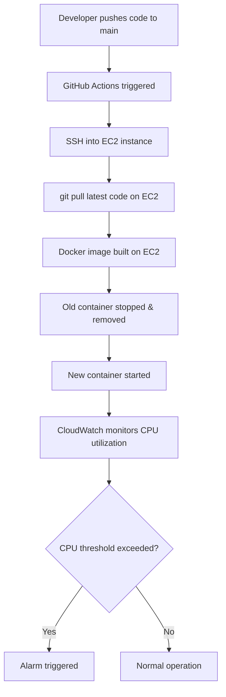

# CI/CD Deployment Pipeline with Automated Monitoring

A fully automated deployment pipeline that takes a Flask application from a single `git push` to a live, monitored production environment on AWS — no manual steps required.

## Overview

This project replaces a manual 5-step deployment process (build → package → transfer → restart service → verify) with a single automated pipeline. On every push to the main branch, the app is containerized, tested, and deployed to an AWS EC2 instance automatically, with CloudWatch monitoring in place to track system health post-deployment.

## Tech Stack

- **Application**: Python, Flask
- **Containerization**: Docker
- **CI/CD**: GitHub Actions
- **Cloud Infrastructure**: AWS EC2
- **Monitoring**: AWS CloudWatch

## Architecture


## How It Works

1. **Containerization**: The Flask application is packaged into a Docker image, ensuring consistent behavior across environments.
2. **CI/CD Pipeline**: A GitHub Actions workflow (`.github/workflows/deploy.yml`) is triggered on every push to `main`. It builds the Docker image and deploys it to the target EC2 instance.
3. **Automated Deployment**: The EC2 instance pulls and runs the latest container automatically — no manual SSH steps, no manual restarts.
4. **Monitoring**: A CloudWatch alarm tracks EC2 CPU utilization, providing visibility into instance health after each deployment.

## Setup

### Prerequisites
- AWS account with an EC2 instance configured
- Docker installed locally (for local testing)
- GitHub repository with Actions enabled

### Configuration
1. Add the following secrets to your GitHub repository (`Settings → Secrets and variables → Actions`):
   - `AWS_ACCESS_KEY_ID`
   - `AWS_SECRET_ACCESS_KEY`
   - `EC2_HOST`
   - `EC2_SSH_KEY`
2. Push to `main` — the pipeline runs automatically.

### Local Testing
```bash
docker build -t flask-cicd-app .
docker run -p 5000:5000 flask-cicd-app
```

## Impact

- Reduced deployment time and manual effort by replacing a 5-step manual process with a single `git push`
- Improved deployment reliability by removing manual steps prone to human error
- Added visibility into production health via CloudWatch monitoring

## Future Improvements
- Add automated rollback on failed health checks
- Expand monitoring to include memory and request-latency metrics
- Add a staging environment before production deployment
